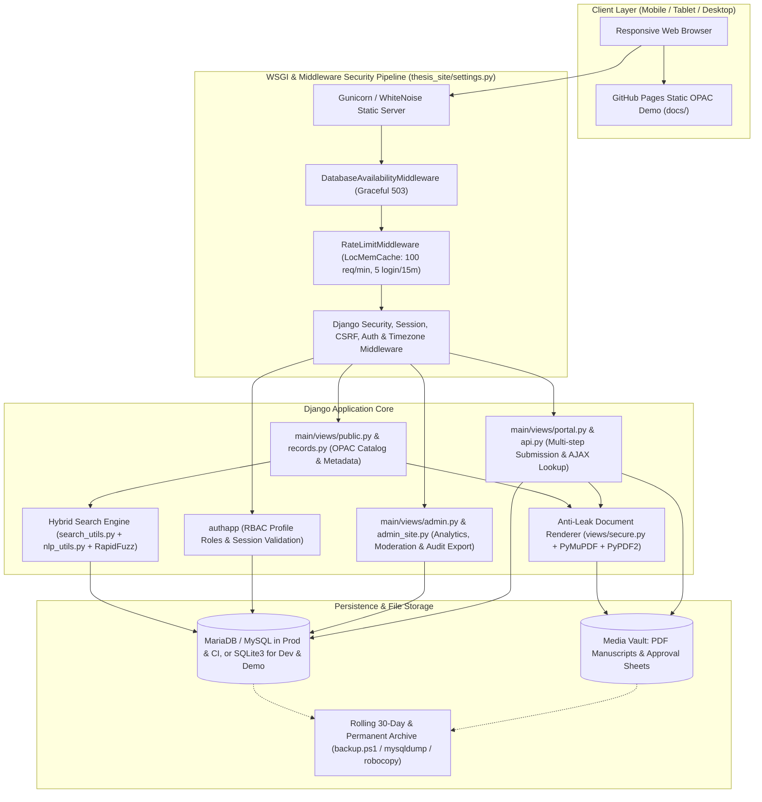
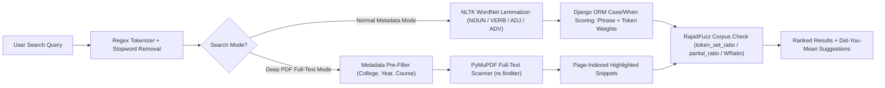
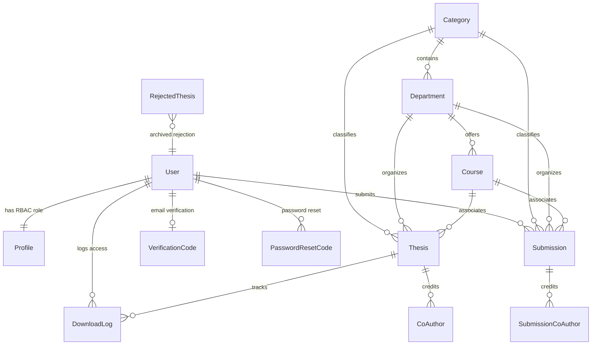

# TCU Theses Library Archiver 📚🎓

[](https://tofuwho.github.io/ThesisLibrary/)
[](https://codespaces.new/Tofuwho/ThesisLibrary)
[](https://www.python.org/)
[](https://www.djangoproject.com/)
[](https://mariadb.org/)
[](Dockerfile)
[](https://render.com/deploy?repo=https://github.com/Tofuwho/ThesisLibrary)
[](https://github.com/Tofuwho/ThesisLibrary/actions/workflows/main.yml)

> **Institutional Digital Theses, Capstone, and Dissertations Repository (TCU-IR) for Taguig City University.**  
> Built with a security-hardened **Django 4.2** backend, an **NLP/PyMuPDF Hybrid Search Engine**, **server-side anti-leak document rasterization**, **Library of Congress (LCC) & Dublin Core cataloging**, and a **cross-platform responsive OPAC web interface**.

---

## 📋 Repository Description & Tags

**Short Description (GitHub About):**
> Institutional Digital Theses & Dissertations Repository (OPAC) for Taguig City University built with Django 4.2, Hybrid NLP/PyMuPDF Deep PDF Search, RapidFuzz query correction, server-side watermarked view-only PDF streaming, Dublin Core & LCC cataloging, and a responsive GitHub Pages live demo.

**Repository Tags / Topics:**

`django` · `python` · `institutional-repository` · `thesis-repository` · `digital-library` · `opac` · `dublin-core` · `library-of-congress-classification` · `pymupdf` · `rapidfuzz` · `nltk` · `anti-leak-viewer` · `mariadb` · `sqlite` · `docker` · `responsive-design` · `academic-archive` · `taguig-city-university`

---

## 🌐 Live Demo Environments

Evaluate the system immediately without local installation using either option below:

### 1. Interactive Static OPAC Demo (GitHub Pages)
👉 **[Launch GitHub Pages Live Demo](https://tofuwho.github.io/ThesisLibrary/)**
* **Multi-Platform Responsive Design**: Unified sticky header, mobile slide-out navigation drawer, swipeable record tabs, collapsible OPAC filter facets, and horizontally scrollable metadata/moderation tables across phones, tablets, and desktops.
* **Library OPAC Search & Faceting**: Instant scope-targeted search (*Title, Author, Subject, Call Number*) and live facet counts across collegiate departments, degree levels, and defense years.
* **Dublin Core & Citation Exporter**: Embedded ISO 15836 `DC.*` metadata tags, complete Dublin Core inspection tables, and 1-click citations in **APA 7th, MLA 9th, IEEE, Chicago/Turabian, and BibTeX**.
* **Protected Manuscript Viewer & Role Switcher**: Simulated watermarked reader enforcing RA 8293 non-distributive access, plus live persona switching (*Guest, Student, Faculty Adviser, Chief Librarian, Admin*) and Chart.js moderation analytics.

### 2. Full Dynamic Django Backend (GitHub Codespaces)
👉 [](https://codespaces.new/Tofuwho/ThesisLibrary)
* Provisions a Python 3.11 container (`.devcontainer/devcontainer.json` + `.devcontainer/setup.sh`).
* Automatically installs dependencies, migrates and seeds the SQLite database (`seed_demo_data.py`), collects static files, and launches the live Django server on forwarded port `8000`.

### 🔑 Pre-Seeded Demo Account Credentials

Used in GitHub Codespaces, Docker, Render, and local SQLite quick-starts:

| Role | Username | Password | Capabilities & Permissions |
|---|---|---|---|
| 🛡️ **Administrator** | `admin` | `admin12345` | Full system oversight, user/staff pre-registration, audit logs, `.xlsx` export, archive tools |
| 📖 **Librarian** | `librarian` | `librarian12345` | Submission moderation queue, LCC call number assignment, full watermarked manuscript viewer |
| 👨‍🏫 **Professor / Adviser** | `professor` | `professor12345` | Advisee review states (`ready_for_approval` / `recommend_reject`), faculty catalog access |
| 🎓 **Student Author** | `student` | `student12345` | Multi-step thesis submission wizard with auto-save, co-author lookup, 3-page preview reader |

---

## 🛠️ Complete Tech Stack

| Layer | Technologies & Packages | Purpose in System |
|---|---|---|
| **Web Framework** | **Python 3.11+**, **Django 4.2** | MVT web framework, custom Django Admin (`CustomAdminSite`), authentication, ORM, templating |
| **Database Engines** | **MariaDB / MySQL** (`mysqlclient 2.2.7`, `mysql-connector-python 9.4.0`), **SQLite3** | Production/XAMPP relational storage with automatic zero-config SQLite fallback (`thesis_site/settings.py`) |
| **Search & NLP** | **RapidFuzz 3.9.7**, **NLTK 3.9.1** (WordNet + English dictionary), Regex tokenization | Query lemmatization (`WordNetLemmatizer`), weighted phrase/token ORM scoring, *"Did you mean…?"* typo correction |
| **PDF & Document Pipeline** | **PyMuPDF (`fitz` 1.26.4)**, **PyPDF2 3.0.1**, **pdfplumber 0.11.9**, **ReportLab 4.4.3** | Full-text indexing, metadata/abstract auto-extraction, 3-page preview slicing, server-side watermarked 2.0× PNG rasterization |
| **Data & Reporting** | **OpenPyXL**, **Pillow 11.3.0**, **Chart.js** | Formatted Excel audit log exports, image assets, and interactive repository analytics dashboards |
| **Frontend UI** | **HTML5**, **CSS3**, **Vanilla JS (ES6 modules)**, **FontAwesome**, **Google Fonts** | Modular UI (`main.js`, `auth.js`, `student.js`, `categories.js`), responsive OPAC drawer (`demo-nav.css`), `Atkinson Hyperlegible` & `Crimson Pro` fonts |
| **App Server & Static** | **Gunicorn**, **WhiteNoise**, **python-dotenv** | WSGI HTTP serving, compressed manifest static asset delivery, `.env` configuration management |
| **CI/CD & Infra** | **GitHub Actions**, **Docker**, **Docker Compose**, **Render**, **Codespaces** | Ruff linting, MySQL 8.0 automated Django test suite, containerized builds, 1-click cloud blueprints |
| **Backup & Ops** | **PowerShell (`backup.ps1`)**, **Windows Batch**, **`mysqldump`**, **`robocopy`** | Automated 30-day rolling disaster recovery backups + immutable permanent manuscript archive |

---

## 🏗️ System Architecture

### High-Level Architecture Diagram



### Request Security & Middleware Pipeline

Incoming requests pass through a hardened middleware stack configured in `thesis_site/settings.py`:

1. **`DatabaseAvailabilityMiddleware` (`main/middleware/db_check.py`)**: Placed first in the pipeline to catch MySQL/SQLite `OperationalError` codes (`2002`, `2003`, `2006`, `2013`, `1040`) and render a helpful `503` maintenance status page rather than exposing stack traces.
2. **`RateLimitMiddleware` (`main/middleware/ratelimit.py`)**: Uses atomic cache counters (`LocMemCache`) per client IP to enforce a global rate limit (`100 requests / 60s`) and strict credential-stuffing protection (`5 POST attempts / 900s` on `/auth/login/` and `/admin/login/`).
3. **`WhiteNoiseMiddleware`**: Serves compressed manifest static assets directly from Django without needing Nginx/Apache aliasing in container or PaaS environments.
4. **Hardened Headers & Sessions**: `SECURE_CONTENT_TYPE_NOSNIFF`, `X_FRAME_OPTIONS = 'SAMEORIGIN'`, `SESSION_COOKIE_HTTPONLY = True`, `SESSION_COOKIE_SAMESITE = 'Lax'`, dynamic LAN IP discovery for offline/campus deployment, and custom AJAX-aware `csrf_failure` responses.
5. **`UserTimezoneMiddleware` (`main/middleware/timezone_middleware.py`)**: Synchronizes user session timezone handling (`Asia/Manila` default).

---

## 🔍 Hybrid Search Architecture

Detailed in [`SEARCH_OVERVIEW.md`](SEARCH_OVERVIEW.md), catalog discovery combines three engines in `main/search_utils.py`, `main/nlp_utils.py`, and `main/utils.py`:



* **Normal Mode**: Executes entirely at the SQL/ORM layer using phrase weights (`title: 150`, `abstract: 100`, `author/keywords: 80`, `coauthor: 70`, `department: 50`, `course: 40`) plus lemmatized token weights (`title: 30`, `year: 20`, `author/coauthor: 15`, `abstract/keywords: 10`).
* **Deep Search Mode**: Reads extracted or live PDF text via `PyMuPDF` (`[PG:N]` markers) and returns contextual snippets with highlighted matches. Indexed text is cached in `Thesis.full_text` upon submission approval and can be bulk-rebuilt via `python manage.py reindex_theses`.

---

## 🔒 Anti-Leak & View-Only Manuscript Pipeline

Implemented in `main/views/secure.py` to enforce institutional intellectual property rules (**Republic Act No. 8293**):

1. **Direct Downloads Prohibited**: `/thesis/<pk>/download/` (`download_thesis_file`) unconditionally returns `HTTP 403 Forbidden`.
2. **Restricted General Preview**: Authenticated non-staff users hitting `/thesis/<pk>/restricted/` receive a **PyPDF2-sliced 3-page excerpt** only.
3. **Server-Side Watermarked PNG Streaming**: Librarians and Administrators using `/thesis/<thesis_id>/view/` never download raw full PDFs to the browser. Instead, `serve_thesis_page_image` opens the PDF on the server with PyMuPDF (`fitz`), optionally draws yellow highlight quads around search terms (`?q=...`), inserts `assets/images/watermark.png` underneath, rasterizes at **2.0× resolution**, and streams PNG bytes to `<canvas>`/`` containers.

---

## 🗄️ Database Schema & Models

Core models are defined in `main/models.py` and `authapp/models.py`:



* **Academic Hierarchy**: `Category` (*Undergraduate / Graduate*) → `Department` (*Colleges*) → `Course` (*Degree Programs*).
* **Ingestion & Archival Tables**:
  * `Submission` (`main_pending_submission`): Tracks multi-step student uploads, advisor/co-advisor metadata, approval sheets (`pdf/jpg/png`), review state (`pending`, `ready_for_approval`, `recommend_reject`), and lifecycle methods `.approve()` and `.reject()`.
  * `Thesis`: Approved catalog record holding `lc_classification`, `is_archived` soft-archive flag, PDF `file`, and indexed `full_text`.
  * `RejectedThesis`: Preserves rejected manuscripts, approval sheets, rejection reasons, and original submitter audit references.
* **Institutional Registry & Auth**: Pre-registered verification tables (`Student`, `Professor`, `Librarian`, `AdminStaff`), RBAC `Profile` roles (`admin`, `librarian`, `professor`, `student`), `VerificationCode`, `PasswordResetCode`, and `DownloadLog`.

---

## 📜 Academic Library Protocols & Standards

* **Dublin Core Metadata (ISO 15836)**: Public records expose standardized metadata fields (`dc.title`, `dc.creator`, `dc.contributor.advisor`, `dc.date.issued`, `dc.type`, `dc.publisher`, `dc.subject.classification`, `dc.identifier.uri`, `dc.format.extent`, `dc.language.iso`, `dc.rights`) in HTML `<meta>` tags and record inspection tables.
* **Library of Congress Classification (LCC) & Subject Headings (LCSH)**: Theses carry dedicated `lc_classification` strings alongside Dewey Decimal (DDC) equivalents in the OPAC demonstration layer.
* **Academic Citation Export**: Supports single-click copyable citations formatted in **APA 7th**, **MLA 9th**, **IEEE**, **Chicago/Turabian**, and **BibTeX**.
* **Philippine IP Code (RA 8293) & CHED Alignment**: Restricts raw manuscript redistribution while supporting academic transparency and controlled institutional consultation.

---

## 📂 Verified Project Structure

```text
ThesisLibrary/
├── .devcontainer/                  # GitHub Codespaces cloud IDE configuration
│   ├── devcontainer.json           # Python 3.11 container, port 8000 forwarding, setup hooks
│   └── setup.sh                    # Auto-installs deps, seeds DB, collects static assets
├── .github/
│   └── workflows/
│       ├── main.yml                # CI on main: Ruff lint, check_libs.py, MySQL 8.0 test suite
│       └── test.yml                # CI on test branch: mirrors full MySQL 8.0 verification pipeline
├── assets/                         # Static Django assets (CSS, modular JS, FontAwesome, images)
│   ├── css/                        # Theme, portal, admin dashboard, and mobile responsive stylesheets
│   ├── images/                     # Institutional seals, watermark overlay PNG, building SVGs
│   └── js/                         # main.js, auth.js, student.js, categories.js, modal-handler.js, utils.js
├── authapp/                        # Authentication, RBAC Profile model & session endpoints (/auth/*)
│   ├── migrations/
│   ├── admin.py, models.py, urls.py, views.py
├── docs/                           # GitHub Pages Static Responsive OPAC Demo
│   ├── assets/                     # Demo JS controller (demo.js), OPAC styles (demo-nav.css), Chart.js
│   ├── index.html                  # Repository landing page with particle canvas hero & fast OPAC search
│   ├── categories.html             # 2-column faceted OPAC catalog with collapsible mobile filters & citations
│   ├── thesis_detail.html          # Bibliographic record, Dublin Core table, watermarked viewer & citation tab
│   ├── admin_preview.html          # Archivist moderation queue & Chart.js analytics dashboard preview
│   └── about.html                  # Institutional charter, Dublin Core schema & RA 8293 policy docs
├── main/                           # Core Django repository application
│   ├── management/commands/        # CLI commands: reindex_theses.py, system_audit.py
│   ├── middleware/                 # db_check.py (503 guard), ratelimit.py, timezone_middleware.py
│   ├── migrations/                 # 15 sequential schema migrations
│   ├── templates/                  # Django HTML templates (main/, admin/, errors/, includes/)
│   ├── templatetags/               # department_filters.py custom template filters
│   ├── views/                      # Modular views: public, portal, records, admin, api, auth, secure
│   ├── admin.py, admin_site.py     # CustomAdminSite with activity log dashboard
│   ├── models.py                   # Category, Department, Course, Thesis, Submission, CoAuthors, Logs
│   ├── nlp_utils.py                # NLTK WordNet lemmatizer & dictionary corpus loader
│   ├── search_utils.py             # Weighted phrase/token hybrid search scoring engine
│   ├── urls.py, utils.py, tests.py # Route mapping, PyMuPDF PDF utilities & automated test suite
├── templates/admin/index.html      # Root override for Django admin dashboard
├── thesis_site/                    # Django project root config (settings.py, urls.py, wsgi.py, asgi.py)
├── BACKUP_SETUP.md                 # Rolling 30-day & permanent archive guide (Windows/XAMPP)
├── CODE_STRUCTURE.md               # Refactored JS module & view architecture reference
├── GMAIL_SETUP.md                  # Gmail 2FA App Password SMTP configuration guide
├── SEARCH_OVERVIEW.md              # Deep dive into hybrid metadata, deep PDF & fuzzy search
├── Dockerfile & docker-compose.yml # Containerized deployment setup
├── Procfile & render.yaml          # Gunicorn PaaS / Render Blueprint manifests
├── backup.ps1 & run_backup.bat     # Automated mysqldump + robocopy disaster recovery scripts
├── StartLibraryServer.bat          # Windows quick-launch batch helper
├── check_libs.py                   # Dependency & NLTK corpus health verifier
├── db_timeout.py & update_env_ip.py# DB connectivity & dynamic LAN IP updater helpers
├── manage.py                       # Django CLI entry point
├── requirements.txt                # Pinned Python dependency manifest
└── seed_demo_data.py               # Database initializer for demo roles & 8 faculty theses
```

---

## 🚀 Installation, Deployment & Operations

### Prerequisites
* **Python 3.11+** ([python.org](https://www.python.org/))
* **Git** ([git-scm.com](https://git-scm.com/))
* *(Optional)* **MariaDB / MySQL** (e.g., XAMPP) or **Docker**

### Option A: Quick Start (Plug & Play SQLite Mode)

Zero external database required — `thesis_site/settings.py` automatically falls back to `db.sqlite3` when `DB_NAME` is unset or `DB_ENGINE=sqlite`:

```bash
# 1. Clone the repository
git clone https://github.com/Tofuwho/ThesisLibrary.git
cd ThesisLibrary

# 2. Create and activate a virtual environment
python -m venv venv
# Windows:
venv\Scripts\activate
# Linux/macOS:
source venv/bin/activate

# 3. Install dependencies & verify NLTK/PDF libraries
pip install -r requirements.txt
python check_libs.py

# 4. Run migrations and seed demo accounts & sample theses
python seed_demo_data.py

# 5. Start the development server
python manage.py runserver
```

Visit **`http://localhost:8000`** in your browser.

### Option B: MariaDB / MySQL Setup (Production / XAMPP LAN)

1. Start **MySQL / MariaDB** (or XAMPP Control Panel).
2. Create a database named `thesis_library` and configure `.env` in the repository root:

```env
DB_ENGINE=mysql
DB_NAME=thesis_library
DB_USER=root
DB_PASSWORD=your_password
DB_HOST=127.0.0.1
DB_PORT=3306
DJANGO_DEBUG=True
SECRET_KEY=replace-with-long-random-secret-key

# Optional Gmail SMTP verification & password reset (see GMAIL_SETUP.md)
EMAIL_HOST_USER=your-email@gmail.com
EMAIL_HOST_PASSWORD=your-16-char-app-password
DEFAULT_FROM_EMAIL=your-email@gmail.com
```

3. Run migrations, seed initial data, and start the server:

```bash
python seed_demo_data.py
python manage.py runserver 0.0.0.0:8000
```

*(On Windows LAN setups, see `StartLibraryServer.bat` and `update_env_ip.py`.)*

### Option C: Docker Compose

```bash
docker-compose up --build
```

The container (`python:3.11-slim`) installs native MySQL build dependencies, seeds the SQLite demo database, runs `collectstatic`, and binds port `8000`.

### Option D: 1-Click Cloud Deployment (Render)

This repo includes [`render.yaml`](render.yaml) and [`Procfile`](Procfile):
1. Connect this repository in [Render](https://render.com) via **New + → Blueprint**.
2. Render runs `pip install -r requirements.txt && python seed_demo_data.py && python manage.py collectstatic --noinput` and serves via `gunicorn thesis_site.wsgi:application`.

---

## 🧪 Testing, Auditing & Maintenance

```bash
# Run code linter (matches GitHub Actions CI)
ruff check .

# Run full Django system checks & migration verification
python manage.py check
python manage.py makemigrations --check --dry-run

# Run automated Django test suite
python manage.py test --verbosity 2

# Verify RBAC restrictions, homepage & audit tabs end-to-end
python manage.py system_audit

# Extract and cache PDF full_text across all unindexed theses (use --force to rebuild all)
python manage.py reindex_theses
```

### Automated Backups (Windows / XAMPP)
Configure rolling disaster-recovery backups + an immutable permanent manuscript vault using `run_backup.bat` and `backup.ps1` (see [`BACKUP_SETUP.md`](BACKUP_SETUP.md)):
* **Rolling 30-Day Backups**: `C:\ThesisLibrary_Backups\backup_YYYYMMDD_HHMMSS\` (`db_backup.sql` + `media/`).
* **Permanent Archive**: `C:\ThesisLibrary_Permanent_Archive\` (append-only manuscript preservation).

---

## 🏛️ Academic Colleges & Departments Supported

| Code | Collegiate Unit / Faculty | Degree Coverage Examples |
|---|---|---|
| **CICT** | College of Information and Communications Technology | BSIT, BSCS |
| **CAS** | College of Arts and Sciences | BS Psychology (BSP) |
| **CBA** | College of Business and Administration | BSBA, BS Accountancy (BSA) |
| **CED** | College of Education | BSED |
| **COE** | College of Engineering and Technology | BS Industrial Engineering (BSIE) |
| **CCJ** | College of Criminology | BS Criminology (BSCrim) |
| **CHTM** | College of Hospitality and Tourism Management | BSHM |
| **GS** | Graduate Studies | Master in Information Technology (MIT) |

---

## 📖 Further Documentation

* [`CODE_STRUCTURE.md`](CODE_STRUCTURE.md) — JavaScript module organization, restricted preview views, and UI refactoring notes.
* [`SEARCH_OVERVIEW.md`](SEARCH_OVERVIEW.md) — Detailed specification of weighted scoring, PyMuPDF full-text scanning, and RapidFuzz matching.
* [`BACKUP_SETUP.md`](BACKUP_SETUP.md) — Windows Task Scheduler setup for `mysqldump` and permanent media archiving.
* [`GMAIL_SETUP.md`](GMAIL_SETUP.md) — Configuring Google Workspace / Gmail App Passwords for email verification codes.

---

## 📄 Attribution

Developed for **Taguig City University (TCU)** — University Library & Digital Archives.  
Maintained by **[Tofuwho](https://github.com/Tofuwho)**.
